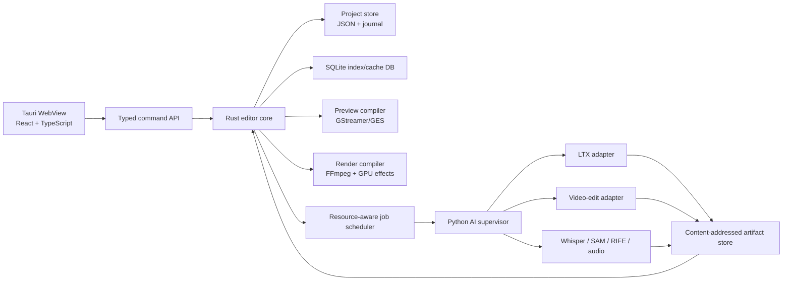

# Local AI Video Editor — Product and Technical Blueprint

Status: architecture proposal  
Date: 2026-08-06  
Primary target: Windows 10/11, one NVIDIA RTX GPU with no more than 16 GB VRAM  
Product principle: local-first, non-destructive, frame-accurate editing with replaceable AI backends

## 1. Executive decision

Build this as a desktop non-linear editor with an AI job system, not as an AI workflow UI with a timeline attached.

The application must remain a useful editor when no AI model is loaded. AI operations create versioned media assets or non-destructive analysis metadata; they do not mutate source media or become hidden dependencies inside the renderer.

The recommended stack is:

- Tauri 2 desktop shell.
- React and TypeScript for the interface.
- Rust for the editor domain, project store, command/undo system, job scheduler and media orchestration.
- GStreamer Editing Services for interactive preview and timeline playback.
- FFmpeg for deterministic transcodes, analysis and final delivery rendering.
- OpenTimelineIO for interchange, not as the complete internal project schema.
- Python workers for model inference, isolated behind versioned contracts.
- SQLite for indexes, job history and disposable cache metadata.
- Human-readable, versioned JSON for the authoritative project document.

The initial model set should be deliberately small:

1. LTX-2.3 as the primary generation, first/last-frame, synchronized audio, video-to-audio and Retake engine.
2. Kiwi-Edit 5B as an experimental instruction/reference video editor after a 16 GB qualification pass.
3. NVIDIA RTX Video SDK for fast final-export super-resolution and artifact reduction.
4. Whisper large-v3-turbo, SAM 2.1, RIFE and DeepFilterNet as lightweight assistance models.

SCAIL-2, VACE 14B, SeedVR2 and other large models belong behind optional adapters. They must not become architectural dependencies.

## 2. Product scope

### 2.1 Core promise

The application takes generated or imported media from clip creation through a professional edit and final delivery, entirely locally:

1. Generate an audio-video clip between first and last images.
2. Generate or replace synchronized sound for an existing clip.
3. Insert generated media on a multitrack timeline.
4. Trim, move, snap, retime, transition, composite, color-correct and mix it.
5. Detect stalls, duplicated frames and candidate seamless joins.
6. Edit a selected shot with an AI video editor while retaining the original as a take.
7. Add titles, lower thirds, captions, interview and news graphics.
8. Restore or upscale the final composition.
9. Export a master, delivery files, stems, captions and a portable project.

### 2.2 Explicit non-goals for the first releases

- No image-generation or image-editing workspace. Images arrive from the separate image harness.
- No attempt to reproduce every feature of Resolve, Premiere or After Effects in version 1.
- No cloud requirement, cloud prompt enhancement or cloud model fallback.
- No arbitrary third-party Python execution inside the main process.
- No promise that generative edits preserve every pixel. The system minimizes changed regions and reports when restoration or rescaling occurred.
- No simultaneous residency of multiple large video models on a 16 GB GPU.

## 3. Hardware and storage budget

### 3.1 Recommended machine

| Resource | Minimum | Recommended | Why |
|---|---:|---:|---|
| NVIDIA VRAM | 16 GB | 16 GB | Hard product ceiling |
| System RAM | 32 GB | 64 GB | Model offload, decode buffers and render cache |
| Project/model NVMe | 1 TB | 2 TB | Models plus active media and cache |
| Free NVMe while editing | 200 GB | 500 GB+ | Proxies, conform files, renders and rollback takes |
| CPU | 8 modern cores | 12–16 cores | Decode, audio, proxy and background analysis |

Thirty-two GB RAM can run the lean profile. Sixty-four GB is the real target because a streamed 22B model, the editor, decoded media and pinned transfer buffers compete for host memory.

### 3.2 Verified model-storage observations

Repository sizes are not install sizes because model repositories often contain alternative or duplicate checkpoints. The model manager must download only selected artifacts.

Measured from Hugging Face metadata on 2026-08-06:

| Component | Relevant size | Notes |
|---|---:|---|
| LTX-2.3 dev checkpoint | 42.98 GiB | Full-quality model |
| LTX-2.3 distilled checkpoint | 42.98 GiB | Fast standalone model |
| LTX distilled LoRA | 7.08 GiB | Used by current two-stage pipelines |
| LTX x2 spatial upscaler | 0.93 GiB | Select one spatial upscaler |
| LTX x2 temporal upscaler | 0.24 GiB | Optional initially |
| Gemma 3 12B text encoder | 22.74 GiB | Can be phase-offloaded |
| Wan2.2 TI2V-5B full repository | 31.85 GiB | Includes 10.58 GiB UMT5 and 2.63 GiB VAE |
| Kiwi-Edit instruct+reference Diffusers package | 19.01 GiB | 5B editor plus 3B multimodal encoder and VAE |
| Wan2.1 1.3B Diffusers base | 26.95 GiB | Most space is its shared text encoder |
| Whisper large-v3-turbo | 1.51 GiB | Transcription and caption source |
| SAM 2.1 Hiera Large | 0.84 GiB per checkpoint format | Download one format, not both |

### 3.3 Installation tiers

| Tier | Contents | Expected disk use |
|---|---|---:|
| Editor only | Application, GStreamer, FFmpeg, shaders and no AI weights | 5–12 GB |
| LTX lean | One LTX checkpoint, Gemma, one upscaler, required adapters and Python runtime | 90–115 GB |
| LTX dual-mode | Dev and distilled checkpoints, Gemma, upscalers, Foley/Retake/LipDub adapters and runtime | 135–165 GB |
| Recommended AI suite | LTX dual-mode, Kiwi-Edit, Whisper, segmentation, audio cleanup and interpolation | 190–260 GB |
| Extended research suite | Recommended suite plus quantized SCAIL/VACE and one high-quality restoration model | 300–450 GB |

The installer must not silently download an entire model repository. It presents named packs, their exact artifacts, license and download size before installation.

### 3.4 Project-media storage

Approximate one-hour storage at common rates:

| Media | Approximate size/hour |
|---|---:|
| 720p proxy at 4 Mbit/s | 1.8 GB |
| 1080p H.264 at 20 Mbit/s | 9 GB |
| 4K HEVC at 60 Mbit/s | 27 GB |
| 1080p ProRes 422 HQ around 220 Mbit/s | 99 GB |
| 4K ProRes 422 HQ around 880 Mbit/s | 396 GB |
| Stereo PCM, 48 kHz, 24-bit | about 1.0 GB |

Uncompressed RGBA frame caches are prohibited as a general cache format: 1080p RGBA is about 8.3 MB per frame and more than 700 GB per hour at 24 fps. Keep only a bounded RAM/GPU frame window. Persistent caches use intra-frame proxies, mezzanine codecs or compressed image tiles.

### 3.5 Storage policy

- Use a content-addressed object store keyed by BLAKE3 hash.
- Deduplicate shared text encoders, VAEs and identical checkpoints across adapters.
- Keep source media immutable.
- Separate disposable cache from project-owned generated takes.
- Let users set independent quotas for thumbnails, waveforms, proxies, render cache and failed AI jobs.
- Use least-recently-used eviction only for reproducible cache artifacts.
- Never evict a generated take, imported source, project file or user-marked render automatically.
- Provide a storage inspector showing ownership and safe-to-delete status.

## 4. Why this application architecture

### 4.1 Tauri and React

Tauri keeps application authority in a memory-safe Rust process while letting the timeline and inspectors use the productive React ecosystem. Tauri can bundle Python/API workers as sidecars and uses an explicit permission model for process execution. The frontend never receives arbitrary shell access.

The browser surface is appropriate for panels, bins, waveform canvases, timeline interaction and property editors. Video frames should not be shuttled through JSON or base64. Preview is provided by the native media service and displayed through a GPU-backed surface or a local zero-copy/shared-texture bridge.

### 4.2 Rust core

Rust owns all authoritative state and operations:

- Timeline math and snapping.
- Project loading, validation, migration and autosave.
- Undo/redo command history.
- Media probing and cache keys.
- Render graph compilation.
- AI resource scheduling and process lifecycle.
- File access and security boundaries.

The TypeScript frontend sends typed commands such as `MoveClips`, `RippleTrim`, `SetRetimeCurve` and `QueueGeneration`. It never directly edits project JSON.

### 4.3 GStreamer Editing Services for preview

GES already models tracks, layers, clips, effects, transitions, edit modes and snapping. It supports timeline preview and rendering and has maintained Rust bindings. This avoids writing a decoder, audio clock, frame scheduler and basic compositor before the product can edit a clip.

We still keep an application-owned domain model. GES is a compiled preview target, not the saved project format. That protects the project from framework changes and lets final rendering use a different backend.

### 4.4 FFmpeg for analysis and final render

FFmpeg supplies broad codec/container support, NVDEC/NVENC, deterministic filter graphs, waveform/audio analysis, loudness normalization, scene/freeze/silence detection, transitions and delivery encoders.

Use a dynamically linked LGPL build by default. Do not casually enable GPL or non-free components in distributed builds. Codec patent and NVIDIA SDK terms require a separate release checklist.

### 4.5 OpenTimelineIO for interchange

OTIO correctly represents editorial concepts such as timelines, tracks, clips, media references, source ranges, gaps, transitions, markers and metadata. It does not embed media and does not represent every proprietary effect. Use it for import/export and embed application-specific data in a namespaced metadata block.

The internal schema remains richer because it needs AI provenance, graph effects, masks, retime curves, caption styles, model hashes and cache lineage.

## 5. Process architecture



### 5.1 Process rules

- The UI process may crash without corrupting the project.
- A failed AI worker may be killed and restarted without restarting the editor.
- Only the Rust supervisor may launch allow-listed workers.
- Workers communicate over loopback gRPC on an ephemeral port with a per-launch token, or an equivalent authenticated local transport.
- Long jobs stream structured progress, preview artifacts, logs and VRAM/RAM telemetry.
- Cancellation is cooperative first and process termination second.
- Every output is written to a staging directory and atomically committed after validation.

## 6. Repository layout

```text
apps/
  desktop/                 Tauri shell and React application
crates/
  editor-domain/           Pure timeline/project types and invariants
  editor-commands/         Commands, undo/redo and transactions
  project-store/           Serialization, migrations, autosave and packaging
  media-probe/             ffprobe/GStreamer discovery and metadata
  preview-engine/          GES compilation and playback control
  render-engine/           Final graph compiler and export queue
  graphics-engine/         Titles, captions, overlays and templates
  resource-manager/        GPU/RAM/disk leases and worker lifecycle
  artifact-store/          Content hashes, cache and generated takes
packages/
  contracts/               JSON Schema and generated Rust/TS/Python types
  ui-components/           Timeline, curves, media bin and inspectors
services/
  ai-worker/               Python supervisor and adapter host
plugins/
  models/ltx-2.3/
  models/kiwi-edit-5b/
  tools/whisper/
  tools/sam2/
  tools/rife/
  tools/deepfilternet/
assets/
  graphics-templates/
  export-presets/
  color/
docs/
tests/
  fixtures/
  golden/
```

Dependencies point inward toward contracts and domain types. Model plugins never import UI packages. The editor domain never imports PyTorch, GStreamer or FFmpeg.

## 7. Canonical project and time model

### 7.1 Time representation

Never store timeline time as floating-point seconds.

Use an exact rational representation compatible with OTIO:

```text
RationalTime {
  value: signed 64-bit integer,
  rate_numerator: unsigned 32-bit integer,
  rate_denominator: unsigned 32-bit integer
}
```

This must correctly represent 23.976, 24, 25, 29.97 drop/non-drop, 30, 50, 59.94 and arbitrary audio sample positions. Convert to GStreamer nanoseconds only at the preview boundary.

Audio edits are sample-accurate internally. Video snapping is frame-accurate. The UI displays SMPTE timecode with explicit drop-frame state.

### 7.2 Core objects

- Project: settings, sequences, media catalog, generated assets, templates and history metadata.
- Sequence: raster, frame rate, working color space, audio layout and track stack.
- Track: video, audio, caption, graphics or control; lock/mute/solo/target states.
- Clip: timeline range, source asset, source range, enabled state and effects.
- Linked group: preserves A/V synchronization while allowing an explicit unlink.
- Transition: overlaps adjacent sources and owns in/out handles.
- Retime map: monotonic or explicitly reversed mapping from timeline time to source time.
- Effect stack: typed parameters with animatable curves and masks.
- Graphic: template reference, text/media bindings, safe-area mode and keyframes.
- Caption cue: text, words, speaker, confidence and style reference.
- Generated take: immutable artifact plus prompt/model/seed/settings lineage.
- Analysis track: scenes, faces, transcript, silence, freeze regions, similarity and quality warnings.

### 7.3 Commands and undo

All state changes are commands with validation and inverse operations. Multi-step user actions are transactions. Dragging a clip may emit transient previews, but mouse release commits one command.

Autosave writes an append-only command journal frequently and periodic compact snapshots. Recovery replays only validated commands after the last snapshot.

## 8. Professional editing feature set

### 8.1 Media and project management

- Import files, folders and image sequences.
- Media bins, smart bins, tags, ratings, labels and search.
- Metadata inspection and editable notes.
- Thumbnail, filmstrip, waveform and contact-sheet views.
- Duplicate detection by content hash.
- Offline/missing-media placeholders and relink by hash, filename or timecode.
- Proxy generation, attach/detach proxy and proxy/original toggle.
- Source and program monitors with in/out points.
- Markers, ranges, subclips and selects sequences.
- Multiple sequences, nested sequences and compound clips.
- Autosave, snapshots, crash recovery and portable archive.

### 8.2 Timeline editing

- Unlimited logical video, audio, caption and graphics tracks.
- Selection, range, blade and trim tools.
- Insert, overwrite, append, replace, lift and extract.
- Ripple trim, roll, slip and slide.
- Asymmetric and multi-track trimming.
- Frame stepping and J/K/L shuttle control.
- Linked selection, grouping, sync lock, track targeting and locking.
- Snapping toggle plus configurable targets: clip edges, playhead, markers, keyframes and selected ranges.
- Gap creation/removal and ripple delete.
- Copy/paste attributes and paste insert/overwrite.
- Adjustment clips and nested compositions.
- Source patching and three-point editing.
- Multicam sync by timecode, waveform or markers; multicam switching is a later milestone.

### 8.3 Retime and motion

- Constant speed, reverse and freeze frame.
- Duration-based speed calculation.
- Variable-speed curves with linear, hold, Bezier and S-curve segments.
- Presets: ease-in, ease-out, speed-up, slow-down, impact ramp and speed pulse.
- Maintain-pitch audio option.
- Frame sampling modes: nearest, blend, optical flow and RIFE.
- Per-clip transform, crop, rotation, anchor, opacity, blend mode and corner pin.
- Stabilization, rolling-shutter correction and motion tracking as staged features.

### 8.4 Transitions and effects

Initial video transitions:

- Dissolve, dip to color, wipe, push, slide, zoom, blur and luma matte.
- Smooth-jump-cut transition using optical flow with a confidence warning.
- User-defined transition presets.

Initial audio transitions:

- Constant-gain, constant-power and configurable-curve crossfades.
- Short automatic edit crossfades to suppress clicks.

Effects expose keyframeable parameters with reusable presets. GPU preview shaders and final-render implementations must share a testable parameter contract.

### 8.5 Color and image finishing

- Input, working and output color-space metadata.
- OpenColorIO/ACES-compatible transform layer.
- CDL/ASC controls, exposure, contrast, pivot, saturation, temperature and tint.
- Lift/gamma/gain and log wheels.
- Curves, hue/saturation operations and LUT support.
- Scopes: waveform, RGB parade, vectorscope and histogram.
- Clip matching and shot-group grades.
- SDR first; HDR10/HLG project and metadata support after the SDR pipeline is proven.
- Work in a linear or scene-referred float space for compositing; avoid repeated 8-bit conversion.

### 8.6 Audio post

- Clip gain and track faders.
- Pan, mute, solo, phase and channel mapping.
- Track EQ, compressor, expander/gate and limiter.
- Sends, buses, submixes and master bus.
- Volume/pan/effect automation curves.
- Sidechain ducking with configurable attack, hold and release.
- Voiceover recording and punch-in.
- Waveform, spectrogram, loudness and true-peak meters.
- EBU R128/ITU BS.1770 loudness measurement and normalization.
- Sample-accurate A/V sync and latency compensation.
- Dialogue cleanup through DeepFilterNet as an optional rendered effect.
- Music/vocal separation through Demucs as an optional analysis/render job.
- Export master mix and user-selected stems.

### 8.7 Captions and transcript editing

- Local transcription with Whisper large-v3-turbo.
- Word timestamps, confidence and manual correction.
- Speaker labels when an optional locally licensed diarization adapter is installed.
- Text-based deletion that creates timeline edits after user confirmation.
- SRT, VTT, ASS and TTML import/export.
- Multiple languages and multiple caption tracks.
- Burn-in or sidecar delivery.
- Advanced styles: word highlighting, karaoke progression, speaker colors, emphasis, background boxes, outline/shadow and safe-area collision handling.
- Caption line breaking based on characters, words, duration, pauses and reading speed.

### 8.8 Graphics, news and interview overlays

Create a template system rather than hard-coding individual overlays. Templates are declarative JSON plus SVG/vector assets, fonts and optional shader/effect references. Render text with HarfBuzz-quality shaping and a GPU/vector renderer.

Required templates:

- Lower thirds and interview name/title straps.
- News headline, location/date bug and breaking-news banner.
- Scrolling ticker and crawl.
- Channel logo/bug and watermark.
- Picture-in-picture, split screen and interview two-box/three-box layouts.
- Quote cards, callouts, arrows, highlights and labels.
- Social handles, subscribe/follow cards and QR codes.
- Scoreboards, timers, counters and data-bound tables.
- Intro/outro slates, chapter cards and credits.
- Safe areas for broadcast and vertical/social formats.

Template authors expose only intended controls. Brand packs define fonts, palettes, spacing, logos, animation durations and approved variants.

## 9. AI generation design

### 9.1 LTX operations

Expose LTX as capabilities, not one giant settings form:

- `generate_between_keyframes`: first/last or multiple-keyframe audio-video generation.
- `generate_audio_video`: text/image-conditioned joint generation.
- `generate_foley`: video-to-audio with the official Foley V2A LoRA.
- `retake_range`: regenerate video, audio or both inside a selected interval.
- `audio_to_video`: generate video while conditioning on existing audio.
- `lip_dub`: optional distilled pipeline for rephrasing/re-voicing.
- `video_transform`: IC-LoRA video-to-video operation.

LTX constraints are adapter validation rules, including resolutions divisible by 32 and Retake frame counts conforming to `8k+1`. The UI converts a timeline selection to a padded valid model window and shows the preserved/replaceable regions before starting.

Every successful generation creates:

- Original encoded output.
- Separate video and audio streams when available.
- Poster frame and preview proxy.
- Generation manifest containing prompt, negative prompt, seed, model artifact hashes, adapter version, precision, offload profile, frame rate, dimensions, steps and elapsed/resource metrics.
- A timeline clip linked to its audio, placed at the selected insertion point.

Generated clips are immutable. Regeneration creates alternate takes that can be auditioned and switched without moving the timeline item.

### 9.2 Fast and quality profiles

| Profile | LTX path | Purpose |
|---|---|---|
| Preview | Distilled, low working raster, tiled decode | Composition and seed search |
| Balanced | Distilled two-stage with spatial upscale | Default iteration |
| Quality | Dev/two-stage HQ with FP8 cast and phase offload | Approved shot generation |

The application must show when FP8, block offload, caching or step reduction changes the requested model path. “Automatic” optimization may never silently substitute a more destructive quantization.

## 10. AI video editing and restoration

### 10.1 Editing hierarchy

Use the least generative operation capable of producing the requested result:

1. Traditional transform, mask, color or compositing.
2. Tracking, segmentation, optical flow or temporal inpainting.
3. LTX Retake for a selected temporal repair or audio-only replacement.
4. Kiwi-Edit for instruction/reference editing.
5. A larger optional VACE/SCAIL adapter only when its specialty is required.

This preserves source quality and avoids unnecessary hallucination.

### 10.2 LTX Retake

Retake is the default repair model for LTX-generated shots because it encodes existing audio/video, masks a temporal region and preserves content outside it. It can independently regenerate audio or video.

It is not a general object editor. The UI should describe it as “regenerate selected time” and distinguish it from instruction-based masked edits.

### 10.3 Kiwi-Edit 5B

Kiwi-Edit is the leading initial research adapter for natural-language edits because it supports:

- Style changes.
- Add, remove and replace.
- Background replacement.
- Reference-image plus instruction editing.
- 81-frame 720×1280 training/inference configurations.

Its published Diffusers package is about 19 GiB on disk and combines a 5B Wan2.2 video model with a 3B multimodal encoder. That makes a 16 GB implementation plausible through sequential component offload, tiled VAE decode and FP8/INT8 transformer storage, but the project does not publish a 16 GB requirement. It remains disabled in the production model catalog until our qualification suite proves it stays below the configured VRAM ceiling.

### 10.4 Matching input quality

No generative editor can promise that an edited frame is pixel-identical outside its intended concept without controls. Implement the following quality-preservation pipeline:

1. Decode and retain the original at source resolution and bit depth.
2. Generate an edit mask, expanded only by a configurable feather region.
3. Run the model at its supported raster using proxies only for previews.
4. Restore/upscale the generated result to the original raster when necessary.
5. Warp and composite only the accepted region into the untouched original.
6. Match exposure, white balance, local contrast, grain/noise and sharpness at the boundary.
7. Run temporal flicker and boundary checks.
8. Store the AI result as a new take, never overwrite the source.

The inspector must show the model raster, output raster, mask and any restoration stages so “matching quality” is auditable.

### 10.5 Upscaling and restoration

Use two tiers:

- Fast/default: NVIDIA RTX Video SDK Super Resolution and artifact reduction. NVIDIA explicitly supports offline creative processing, DX11/DX12/Vulkan/CUDA and RTX 20-series or newer GPUs.
- Quality/optional: SeedVR2 or a later qualified one-step restoration model, tiled and temporally chunked. This runs as a separate job and must pass the 16 GB qualification suite.

RTX Video Super Resolution is not merely a driver playback effect here; integrate the RTX Video SDK’s offline processing path. Store its SDK version and parameters in export metadata.

### 10.6 Other local assistance tools

| Function | Default implementation | AI/advanced option |
|---|---|---|
| Scene detection | Histogram/content cuts and PySceneDetect | Semantic shot labels later |
| Freeze/stall detection | Frame difference, SSIM, optical flow | Learned perceptual similarity |
| Frame interpolation | Optical flow/frame blend | RIFE |
| Subject masks | Manual shapes/chroma | SAM 2.1 video masks |
| Point tracking | KLT/feature/optical-flow tracker | Optional model adapter with acceptable license |
| Speech transcription | Whisper large-v3-turbo | Alignment/diarization adapter |
| Dialogue cleanup | EQ/gate/compressor | DeepFilterNet |
| Music stems | None | Demucs |
| Smart reframe | Face/subject boxes plus smoothing | SAM-guided subject crop |
| Jump-cut smoothing | Crossfade/optical flow | RIFE-assisted short morph |
| Audio creation | Library/recorded audio | LTX Foley V2A and text-to-audio |

CoTracker is useful technically but its published checkpoint is CC BY-NC. Do not make it a default commercial dependency; keep model-license policy inside adapter manifests.

## 11. Seam, pause and duplicate-frame assistant

Generated clips often contain low-motion plateaus near their beginning or end. Automatic destructive removal would also delete intentional pauses, so this feature proposes edits and provides an A/B preview.

### 11.1 Analysis

For each frame compute a compact feature record:

- Luma/chroma histogram distance.
- Downsampled perceptual hash.
- SSIM against neighboring frames.
- Mean and percentile optical-flow magnitude.
- Edge-map difference.
- Optional compact learned embedding.
- Audio RMS, onset and spectral-flux values for the same interval.

Mark a candidate stall only when low motion persists over a minimum duration and is not explained by a detected scene cut, fade or user marker.

For adjacent clips, construct a similarity matrix between a configurable outgoing window and incoming window. Search for a monotonic high-similarity path rather than choosing one nearest pair. This finds duplicated action or overlapping generated frames.

### 11.2 Suggested edit

A suggestion contains:

- Proposed outgoing/incoming trim points.
- Confidence and contributing metrics.
- Number of removed frames.
- Audio regions affected.
- Suggested visual treatment: hard cut, dissolve, optical-flow blend or RIFE bridge.
- Suggested audio treatment: cut, constant-power crossfade or maintained ambience bed.

### 11.3 Audio correctness

Generated A/V begins as a linked group. Removing video source frames removes the exact corresponding source-time interval from its audio. The cut occurs on sample boundaries and receives a short configurable equal-power crossfade to prevent clicks.

Variable-speed edits use the same retime map for audio. `preserve_pitch=true` invokes a phase-vocoder/Rubber Band-style time stretch; otherwise pitch follows speed. If a visual overlap is introduced without equivalent audio overlap, the UI must show the deliberate sync offset.

## 12. Frontend information architecture

### 12.1 Main workspace

```text
+------------------------------------------------------------------+
| Menu / project / workspace / performance and storage indicators  |
+----------------------+--------------------------+----------------+
| Media / Generations  | Source / Program Viewer  | Inspector      |
| Bins / Effects / AI  | A/B Trim / Scopes        | Clip/AI/Color  |
+----------------------+--------------------------+----------------+
| Timeline tools, snapping, markers, zoom and transport            |
| V4  graphics and overlays                                        |
| V3  adjustment/effects                                           |
| V2  titles/B-roll                                                 |
| V1  primary picture                                              |
| A1  production audio                                             |
| A2  dialogue / music / effects                                   |
+------------------------------------------------------------------+
| Jobs / render queue / AI progress / warnings                     |
+------------------------------------------------------------------+
```

Panels are dockable and workspace layouts are saved per user. Keyboard shortcuts are command identifiers with editable mappings, not hard-coded DOM handlers.

### 12.2 AI interaction principles

- AI starts from a selected clip/range and produces a visible job specification.
- Show estimated disk, VRAM profile and expected model raster before running.
- Preview/draft and final/quality are distinct buttons.
- Keep prompts and model parameters in clip provenance.
- Surface deterministic controls first: mask, range, reference, seed and strength.
- Present results as takes with compare, accept and reject.
- Never block normal editing while a CPU-only analysis runs.
- GPU AI jobs may pause high-quality preview and explain why.

## 13. Model plugin contract

Each model adapter ships a manifest similar to:

```json
{
  "id": "ltx-2.3",
  "adapterVersion": "1.0.0",
  "modelVersion": "2.3",
  "license": {
    "spdx": null,
    "name": "LTX-2 Community License Agreement",
    "url": "https://huggingface.co/Lightricks/LTX-2.3/blob/main/LICENSE",
    "acceptanceRequired": true
  },
  "capabilities": [
    "keyframe_to_audio_video",
    "video_to_audio",
    "retake_audio",
    "retake_video"
  ],
  "artifacts": [],
  "resourceProfiles": {
    "preview": { "maxVramMiB": 14336, "minRamMiB": 32768 },
    "quality": { "maxVramMiB": 14336, "minRamMiB": 49152 }
  },
  "parameterSchema": "schemas/ltx-2.3-generation.schema.json"
}
```

Required adapter methods:

- `probe`: report environment, GPU support and installed artifacts.
- `plan`: validate inputs and return stages/resources without executing.
- `install`: download selected, hash-verified artifacts after license acceptance.
- `run`: execute a planned job and stream typed progress.
- `cancel`: request safe cancellation.
- `unload`: release model and CUDA allocations.
- `diagnose`: run a small known fixture and report output/resource metrics.

Adapters may not write directly into projects. They return staged artifacts and manifests to the Rust core.

## 14. VRAM and model-lifecycle manager

### 14.1 Budget

A nominal 16 GB GPU is not treated as having 16 GB available. Default budgets:

- 14.0 GiB maximum committed AI allocation on a display-attached Windows GPU.
- 1.0–1.5 GiB reserved for desktop, preview compositor and driver variance.
- Lower automatic budget when real-time telemetry shows other applications using VRAM.

The user may override the reserve, but the job manifest records it.

### 14.2 Resource leases

GPU consumers acquire leases:

- Preview-low: decode and compositor only.
- Preview-high: full-resolution effects and scopes.
- AI-exclusive: one large model job; preview falls back to proxy/CPU decode.
- Encode: NVENC and final compositor.
- Utility: small models that may coexist only when measured safe.

Large model jobs are serialized. CPU analysis may continue subject to RAM and disk-I/O limits.

### 14.3 Optimization order

Apply memory reductions in this order:

1. Unload unused model components.
2. Run text/image encoders in a separate phase and offload them.
3. Tile VAE encode/decode.
4. Use efficient attention kernels.
5. Use official FP8 cast or validated INT8 weights.
6. Block/leaf offload between pinned host RAM and GPU.
7. Reduce temporal window or working raster with an explicit user-visible plan.
8. Disk streaming only as an emergency profile.

Do not default to four-bit weights merely because they fit. Quantized variants need visual-regression qualification against the reference checkpoint.

### 14.4 Block and leaf offload

The model runtime exposes components as loadable units with measured resident bytes and transfer cost. A planner chooses among:

- Whole-component phase offload.
- Transformer block streaming.
- Leaf-module streaming for unusually large blocks.
- Double-buffered asynchronous transfers to overlap compute and PCIe copies.
- Pinned-RAM pool with a hard cap and backpressure.

Never let multiple adapters invent incompatible offload systems inside the main application. Wrap their runtime-specific implementations behind a common memory-plan report.

## 15. Preview, cache and final render

### 15.1 Preview

- Decode proxies when available.
- Composite at viewer resolution, not automatically at project raster.
- Cache thumbnails, waveforms and nearby decoded frames.
- Cache expensive effect segments as short mezzanine files.
- Drop preview frames rather than desynchronize audio.
- Use the audio clock as playback authority.

### 15.2 Render graph

The domain sequence compiles into an immutable render graph:

1. Resolve media references and takes.
2. Decode original media.
3. Apply exact source ranges and retime maps.
4. Apply clip effects and masks.
5. Composite tracks in working color space.
6. Apply track/adjustment effects.
7. Render captions and graphics.
8. Mix audio tracks, buses and automation.
9. Apply output color transform.
10. Optionally run RTX restoration/upscale before encode.
11. Encode/mux and validate output.

AI generation is normally precomputed. A final render must never unexpectedly launch a multi-hour generative job. Missing AI artifacts block render with a clear dependency report.

### 15.3 Cache keys

Every render-cache key includes:

- Source content hash and source range.
- Timeline/render graph subtree hash.
- Effect/plugin versions and parameters.
- Color configuration hash.
- Output raster, frame rate and pixel format.
- AI artifact hash when applicable.

Changing an unrelated clip must not invalidate the whole sequence.

## 16. Export and project portability

### 16.1 Delivery exports

Initial delivery presets:

- H.264/AVC and H.265/HEVC through NVENC where permitted.
- AV1 through NVENC on supported GPUs.
- ProRes-compatible mezzanine and image sequences through FFmpeg-compatible encoders.
- PNG/TIFF/EXR image sequences.
- AAC, Opus, FLAC and WAV/PCM audio.
- Separate dialogue, music, effects and master stems.
- SRT, VTT, ASS and TTML captions.

Render presets specify codec, profile, level, rate control, color tags, audio layout, loudness target, caption mode and metadata. Validation checks duration, stream count, time base, first/last decoded frames, audio peak/loudness and A/V sync.

### 16.2 Project format

Use a directory during editing and an optional ZIP-compatible package for transfer:

```text
ProjectName.aivproj/
  manifest.json
  project.json
  timeline.otio
  assets/
    generated/
    graphics/
    fonts/
  media-links.json
  proxies/                 optional
  source-media/            optional portable archive mode
  captions/
  reports/
```

Models are never embedded. The manifest records required adapter/model hashes and licenses. Import offers to install missing compatible models or preserve affected clips as ordinary rendered media.

Support three package modes:

- Linked: project and generated assets; external source paths remain references.
- Managed: copy used source ranges or full source files into the package.
- Archive: managed media plus proxies, captions, graphics and final reports.

OTIO export is always available. EDL and FCPXML adapters follow after the internal time/transition model is stable. AAF is a later interoperability project, not an early checkbox.

## 17. Reliability, privacy and licensing

- No telemetry by default.
- All services bind to loopback only.
- No API keys are required for core operation.
- Model downloads require explicit consent, destination and license acceptance.
- Record model and adapter licenses separately from application-code licenses.
- Keep a machine-readable restricted-use and commercial-use policy in manifests.
- Validate all imported project paths; never execute project-contained scripts.
- Use signed application/plugin releases and SHA-256/BLAKE3 artifact verification.
- Sanitize subtitle, SVG, font and template inputs.
- Keep FFmpeg/GStreamer codec and license manifests reproducible per release.
- LTX’s community license and revenue/competitive-product terms require legal review before distribution of a commercial editor.

## 18. Testing and quality gates

### 18.1 Non-AI tests

- Property tests for rational time, trim, ripple, roll, slip, slide and snapping.
- Undo/redo round-trip tests for every command.
- Project-schema migration fixtures for every released version.
- Golden-frame tests comparing preview and final render at cuts, effects and transitions.
- Sample-accurate A/V sync tests across trims, speed changes and nested sequences.
- Variable-frame-rate ingest/conform tests.
- Color-transform and alpha-composite image tests.
- Crash recovery and interrupted-write tests.
- Render validation against known stream metadata and frame hashes.

### 18.2 AI qualification suite

Every model/precision/offload profile runs the same fixtures:

- Peak allocated and reserved VRAM must remain below its declared ceiling.
- Peak RAM, page faults, PCIe transfer and elapsed time are recorded.
- Cancellation must release CUDA memory and leave no partial committed artifact.
- Determinism is checked where the backend claims it.
- Reference versus quantized output is scored for perceptual and temporal change.
- Generated A/V sync is measured.
- First/last-frame adherence and identity stability are measured.
- Edited-region and protected-region differences are measured separately.
- Long jobs undergo repeated-run leak and hot-swap tests.

No adapter is labelled “16 GB supported” based only on weight-file size.

## 19. Delivery plan

### Phase 0 — architecture spikes

- Prove GES playback, seek, trim, overlap, snapping and hardware decode on Windows.
- Prove a Tauri-to-native preview surface without frame copies through JavaScript.
- Build a minimal LTX worker and measure exact 16 GB profiles.
- Compile one canonical timeline to both preview and FFmpeg final render.
- Validate RTX Video SDK offline export and its redistributable/license path.

Exit criterion: two clips with linked audio can be trimmed, transitioned, previewed and exported frame-accurately while an LTX job is cancellable and isolated.

### Phase 1 — editor foundation

- Project schema, command system, autosave and recovery.
- Media import, probe, bins, thumbnails, waveforms and proxies.
- Multitrack timeline, snapping, basic trim tools, linked A/V and undo.
- Program/source viewers and basic transforms.
- Cuts, dissolves, audio fades and H.264/H.265 exports.

### Phase 2 — LTX production loop

- Model manager, license acceptance and selective artifact installation.
- First/last-frame generation with audio.
- Foley/video-to-audio generation.
- Generation takes, provenance and automatic timeline placement.
- Retake selected ranges and audio-only replacement.
- VRAM profiles, job queue, cancellation and diagnostics.

### Phase 3 — finishing and AI assistance

- Similarity/stall assistant with linked audio edits.
- Retime curves, presets, optical flow and RIFE.
- Whisper captions and text-based edit suggestions.
- SAM masks, tracking and smart reframe.
- Dialogue cleanup and loudness workflow.
- RTX upscale/artifact-reduction export.
- Kiwi-Edit 16 GB qualification and masked-quality pipeline.

### Phase 4 — professional NLE depth

- Advanced trims, nested sequences, adjustment clips and multicam.
- Color management, scopes, shot matching and HDR groundwork.
- Audio mixer, buses, automation, ducking and stem delivery.
- Expanded transitions/effects and preset management.
- OTIO import/export, followed by FCPXML/EDL.

### Phase 5 — graphics and broadcast workflows

- Declarative motion-graphics engine.
- News/interview/social template packs.
- Data-bound tickers, timers and tables.
- Advanced caption animation and collision management.
- Brand packs and template authoring tools.

### Phase 6 — hardening and ecosystem

- Stable plugin SDK and compatibility policy.
- Signed third-party adapters.
- Migration documentation and sample plugins.
- Performance lab, leak/soak tests and release qualification.
- Optional research-model packs.

A polished professional editor is a multi-release effort. The correct first usable product is a strong conventional editor with an exceptional LTX generation loop, not a shallow implementation of every professional feature.

## 20. Initial implementation backlog

The first development sprint should produce architecture, not visual polish:

1. Establish the monorepo, formatter, linter, test and build conventions.
2. Define JSON Schema contracts and generated Rust/TypeScript/Python types.
3. Implement rational time, media references, tracks, clips and linked groups.
4. Implement command transactions and undo/redo.
5. Build ffprobe media discovery and content hashing.
6. Spike GES preview with two video and two audio tracks.
7. Implement move, trim, split and snapping commands.
8. Compile the same sequence to an FFmpeg export.
9. Add the sidecar supervisor and a fake model adapter for job/cancellation tests.
10. Add an LTX `plan` operation that validates artifacts and predicts resource stages without generation.

Only after these foundations pass frame-accuracy and recovery tests should the full LTX worker and final UI styling be added.

## 21. Principal risks and mitigations

| Risk | Mitigation |
|---|---|
| Preview differs from export | One canonical graph, shared parameter schemas and golden-frame parity tests |
| 16 GB jobs OOM on display GPU | 14 GiB default lease, telemetry, staged loading and mandatory qualification |
| Large-model hot swaps leak RAM/VRAM | Isolated workers, explicit unload, process recycling and soak tests |
| Project becomes tied to one model | Capability-based adapter contract and rendered immutable takes |
| Generative edits lower source quality | Minimum changed region, original-resolution composite and audit metadata |
| Cache consumes entire disk | Quotas, ownership classes, LRU only for reproducible artifacts and storage inspector |
| Codec/license distribution problems | Reproducible LGPL builds, plugin manifests and release legal checklist |
| LTX model license conflicts with product use | Separate model acceptance and legal review before commercial distribution |
| Web UI becomes media bottleneck | Native preview/compositor; never send full frames through frontend IPC |
| Scope expands into an unfinished Resolve clone | Phase gates centered on complete workflows and measurable exit criteria |

## 22. Research references

- [LTX-2 official pipelines](https://github.com/Lightricks/LTX-2/blob/main/packages/ltx-pipelines/docs/pipelines.md)
- [LTX-2 core architecture](https://github.com/Lightricks/LTX-2/blob/main/packages/ltx-core/README.md)
- [LTX-2.3 model card](https://huggingface.co/Lightricks/LTX-2.3)
- [LTX-2.3 Foley V2A LoRA](https://huggingface.co/Lightricks/LTX-2.3-22b-LoRA-Foley-V2A)
- [Kiwi-Edit official repository](https://github.com/showlab/Kiwi-Edit)
- [SCAIL-2 official repository](https://github.com/zai-org/SCAIL-2)
- [VACE official repository](https://github.com/ali-vilab/VACE)
- [NVIDIA RTX Video SDK](https://developer.nvidia.com/rtx-video-sdk)
- [SeedVR2 official repository](https://github.com/IceClear/SeedVR2)
- [Whisper official repository](https://github.com/openai/whisper)
- [SAM 2 official project](https://github.com/facebookresearch/segment-anything-2)
- [RIFE official repository](https://github.com/hzwer/Practical-RIFE)
- [DeepFilterNet official repository](https://github.com/Rikorose/DeepFilterNet)
- [GStreamer Editing Services](https://gstreamer.freedesktop.org/documentation/gst-editing-services/index.html)
- [GES timeline and snapping](https://gstreamer.freedesktop.org/documentation/gst-editing-services/gestimeline.html)
- [FFmpeg filter documentation](https://ffmpeg.org/ffmpeg-filters.html)
- [FFmpeg license considerations](https://ffmpeg.org/legal.html)
- [OpenTimelineIO documentation](https://opentimelineio.readthedocs.io/en/latest/)
- [Tauri sidecar documentation](https://v2.tauri.app/develop/sidecar/)
- [DaVinci Resolve editing feature reference](https://www.blackmagicdesign.com/products/davinciresolve/edit)
- [DaVinci Resolve color feature reference](https://www.blackmagicdesign.com/products/davinciresolve/color)
- [DaVinci Resolve Fairlight feature reference](https://www.blackmagicdesign.com/products/davinciresolve/fairlight)
- [DaVinci Resolve Fusion graphics reference](https://www.blackmagicdesign.com/products/davinciresolve/fusion)

